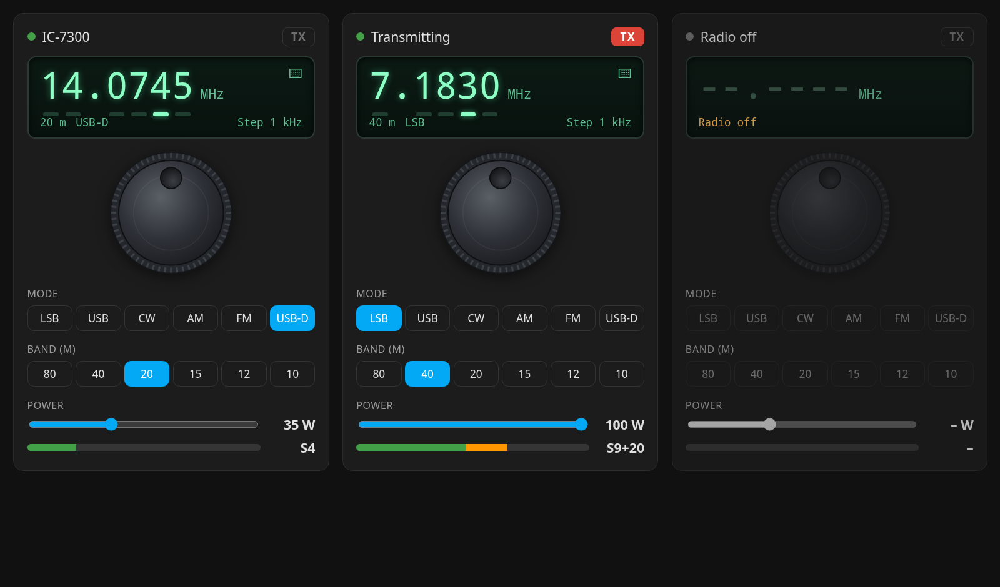

# Ham radio TRX control

A Home Assistant dashboard card with the basics of a transceiver: a **frequency display** and a **tuning knob**, band, **mode** and **transmit power**, an S-meter, and whether the radio is on and transmitting.

- **Tune**: tap the mark under a digit to choose what the knob changes (10 MHz down to 100 Hz), then turn the knob: drag around it, scroll over it, or use the arrow keys. The frequency is sent when the knob stops. ⌨ in the display opens a field to type a frequency.
- **Mode**: tap a mode button. **Band**: tap a band; it tunes to the last frequency you used on that band, else to a default for the mode (data: the JS8 frequency, CW, or the voice part). **Power**: drag the slider.

Made for the entities of [ham-radio-ha-gateway](https://github.com/michalsiman/ham-radio-ha-gateway), which brings a radio into Home Assistant through Hamlib's rigctld and MQTT. Any entities of the same kind work too.



> **Status: under development**, tested with demo data; testing on an Icom IC-7300 follows.

## Install

**HACS**: HACS → ⋮ → *Custom repositories* → `https://github.com/michalsiman/ham-radio-trx-control`, type *Dashboard* → install *Ham radio TRX control* → reload the browser.

**By hand**: copy `dist/ham-radio-trx-control.js` to `/config/www/`, then *Settings → Dashboards → ⋮ → Resources → Add resource*: `/local/ham-radio-trx-control.js`, *JavaScript module*.

## Use

```yaml
type: custom:ham-radio-trx-control
prefix: ic_7300
```

`prefix` is the start of the entity ids the gateway created, from its `device_name`: with `device_name: IC-7300` they are `sensor.ic_7300_frequency`, `number.ic_7300_tune` and so on.

| Option | Default | |
|---|---|---|
| `prefix` | | start of the entity ids (required unless `entities` names them all) |
| `name` | the device name | card title |
| `modes` | `[LSB, USB, CW, AM, FM, PKTUSB]` | mode buttons, in this order; the radio's current mode is added when missing |
| `bands` | `[80m, 40m, 20m, 15m, 12m, 10m]` | band buttons, in this order (160m to 2m) |
| `show_s_meter` | `true` | |
| `show_knob` | `true` | the tuning knob |
| `entities` | | override single entities, see below |

Entities and their defaults, each can be replaced under `entities:`:

| Key | Default entity | Used for |
|---|---|---|
| `online` | `binary_sensor.<prefix>_online` | green dot; the card dims when off |
| `frequency` | `sensor.<prefix>_frequency` | frequency in MHz |
| `tune` | `number.<prefix>_tune` | tuning, in kHz |
| `mode` | `sensor.<prefix>_mode` | current mode |
| `mode_select` | `select.<prefix>_set_mode` | mode buttons |
| `transmitting` | `binary_sensor.<prefix>_transmitting` | red TX |
| `tx_power` | `sensor.<prefix>_tx_power` | power in W |
| `tx_power_set` | `number.<prefix>_set_tx_power` | power slider |
| `s_meter` | `sensor.<prefix>_s_meter` | dB relative to S9, shown in S-units |

Packet modes show as the radio names them: `PKTUSB` as *USB-D*, `PKTLSB` as *LSB-D*.

The card speaks English and Czech, following your Home Assistant language.

## Development

One JavaScript file, no build step. The helpers have tests: `node --test tests/helpers.test.mjs`

## License

MIT, see [LICENSE](LICENSE).
